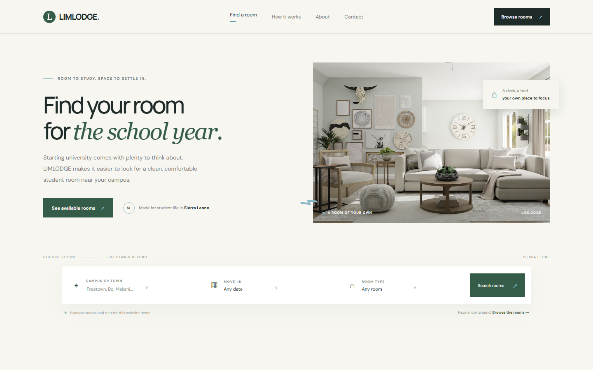
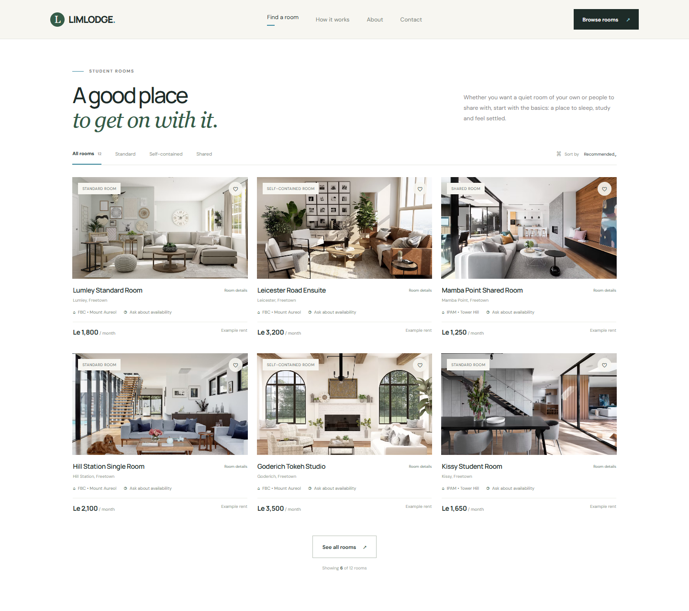
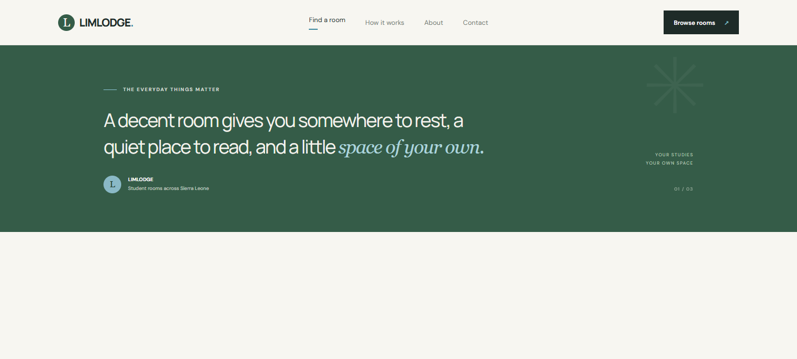
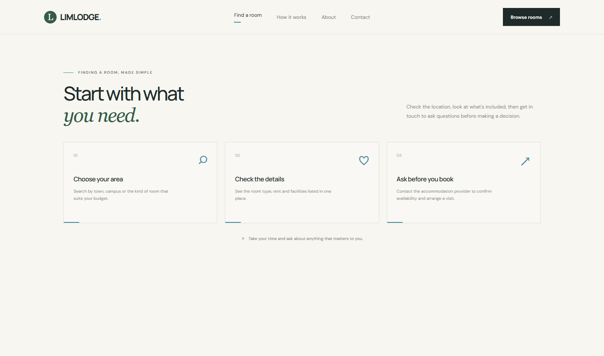
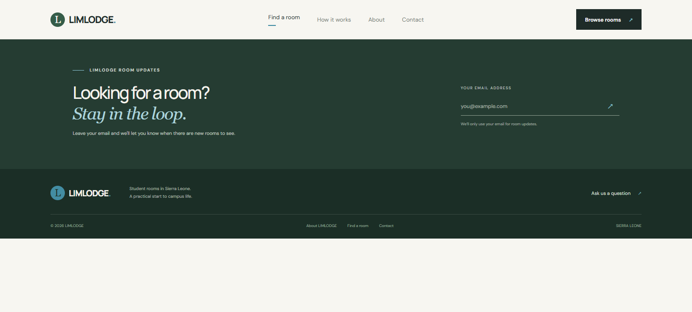

# LIMLODGE student rooms

A responsive accommodation website prototype for university students in Sierra Leone. It is built with HTML, CSS and plain JavaScript.

## Open it

Open `index.html` in a web browser. Fonts and photos are loaded online, so those assets need an internet connection.

## Website features

- Search sample rooms by town, location or campus
- Filter standard, self-contained and shared rooms
- Sort the example rents and save rooms in the browser
- Open each listing for facilities and details
- Mobile navigation and a demo email form

## Website screenshots

The screenshots below show the main sections of the LIMLODGE website.

### Homepage and room search

### Student room listings

### About LIMLODGE

### How it works

### Contact and footer

