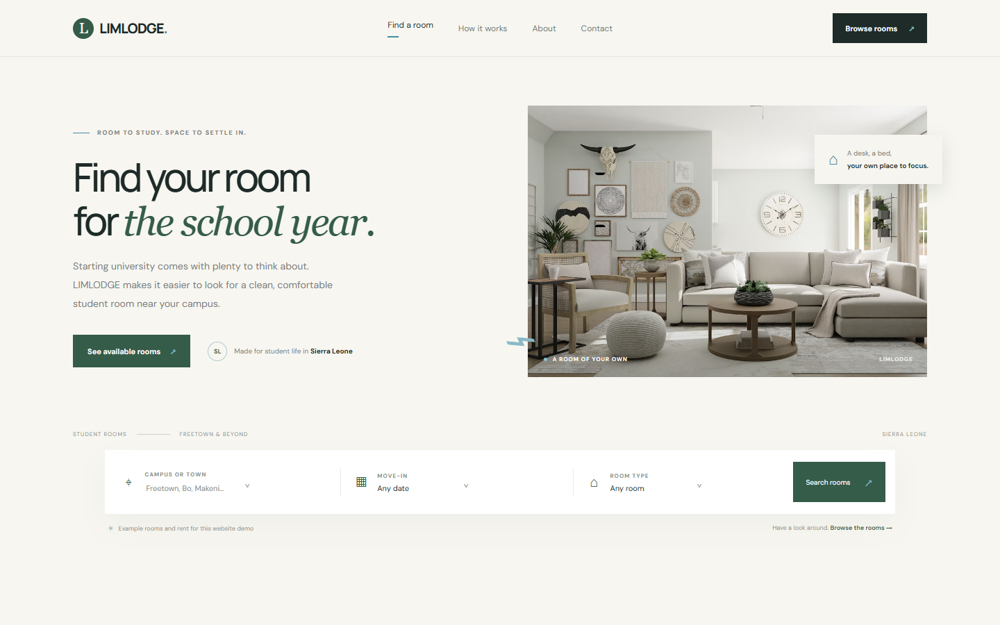
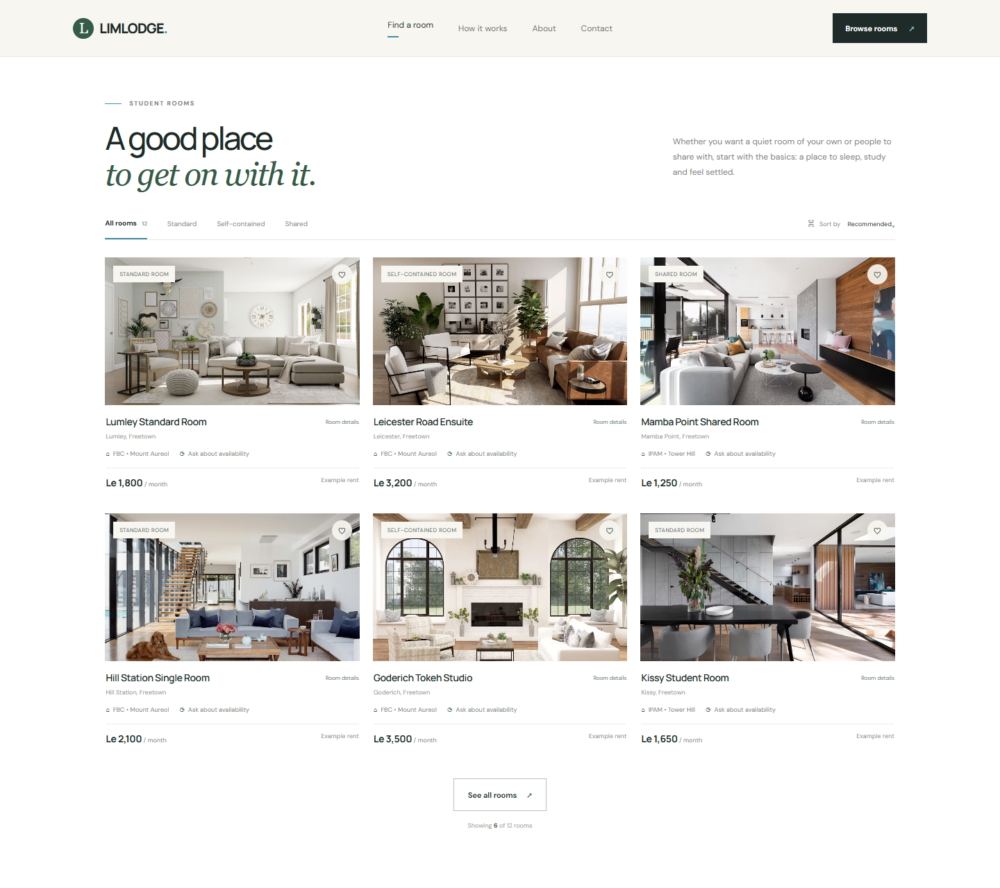
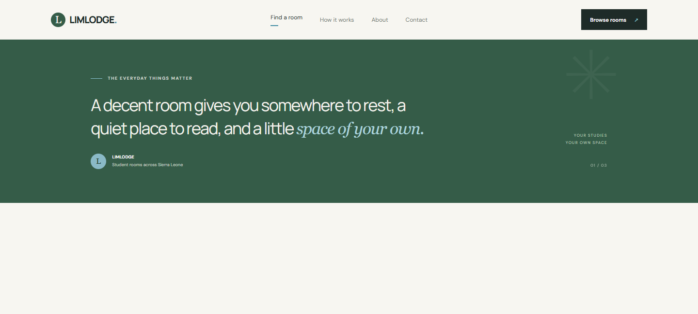
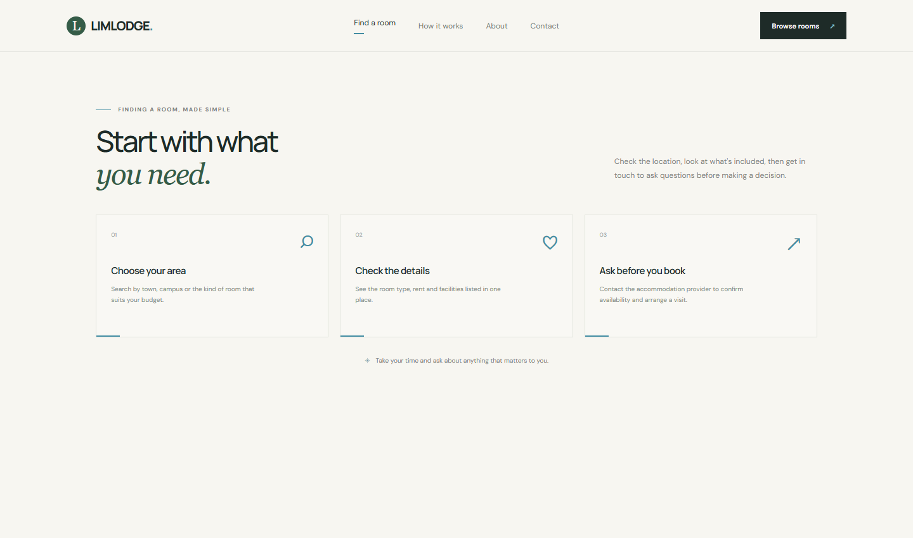
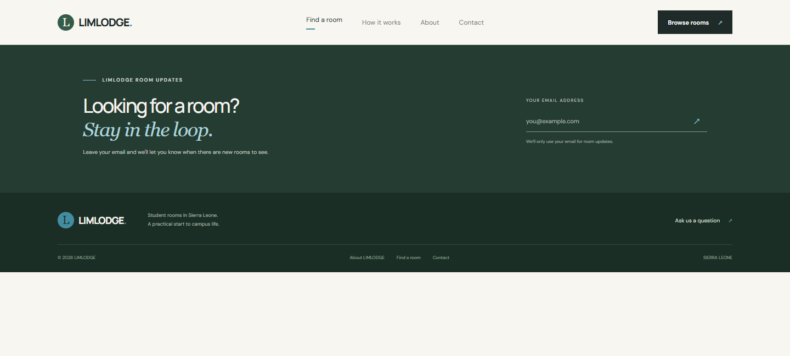

# LIMLODGE Student Accommodation Website

LIMLODGE is a responsive website prototype that helps university students explore and compare example accommodation options in Sierra Leone. It uses HTML, CSS, and JavaScript, with no installation required.

## Pages

| Page | File | What it contains |
| --- | --- | --- |
| Home | `index.html` | Introduction, quick search, and featured room listings |
| About Us | `about.html` | The website’s purpose, mission, accommodation types, and benefits |
| Our Services | `services.html` | Ways students can search, review, and compare rooms |
| Contact Us | `contact.html` | Administrator contact placeholders and a validated contact form |
| Search & Filter Rooms | `rooms.html` | Room listings with search, filters, sorting, saved rooms, and detail views |

## Open the website

1. Download or clone the project folder.
2. Open the folder and double-click `index.html` to launch the home page in a browser.
3. Use the navigation menu to visit the other pages.

The site uses online fonts and room photographs, so an internet connection is needed to load those assets. The website pages themselves are static files and do not require a server.

## Project files

```text
index.html          Home page
about.html          About Us page
services.html       Our Services page
contact.html        Contact Us page
rooms.html          Search and Filter Rooms page
styles.css          Shared styles and responsive layouts
script.js           Room listings, search, filters, and page interactions
README.md           Project guide
homepage.png        Home page screenshot
room-listings.png   Room listings screenshot
about-limlodge.png  About page screenshot
how-it-works.png    Services screenshot
contact-footer.png  Contact and footer screenshot
```

## Features

- Search room names, towns, neighbourhoods, and campus locations.
- Filter example listings by room type, minimum and maximum rent, and facilities.
- Sort rooms by example rent and save favourites in the current browser.
- Open a room card to see its description, facilities, location, and rent.
- Use the responsive navigation and layouts on desktop and mobile screens.
- Validate contact form entries in the browser.

## Sample data and contact form

Room names, photographs, locations, facilities, and rents are demonstration content, not verified offers. Provider contact details have not been supplied. The contact page also contains administrator placeholders; replace them with real details before sharing the site.

The contact form is not connected to an email service. After a valid submission, it tells the visitor that the message was not sent. The home page email sign-up is also a demonstration and does not store or send email addresses.

## Screenshots

These images show examples of the website’s pages and sections:

### Home page and room search



### Room listings



### About Us



### How it works



### Contact and footer


